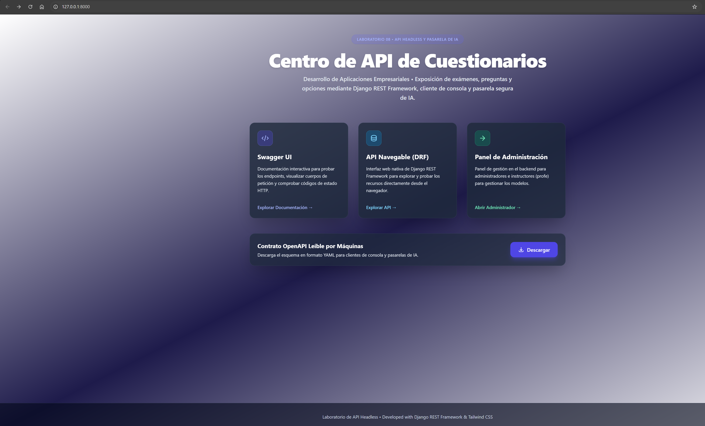
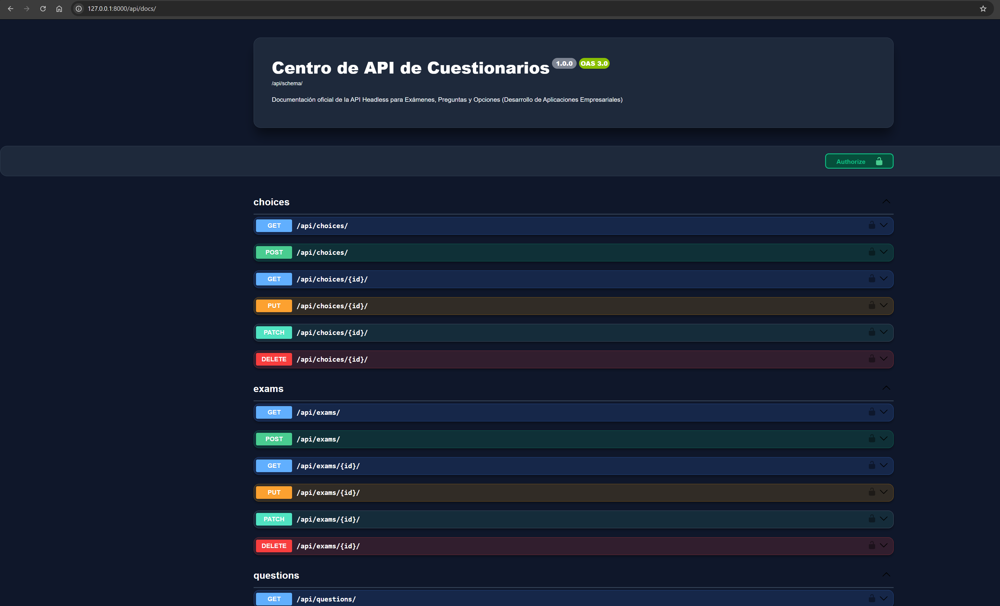
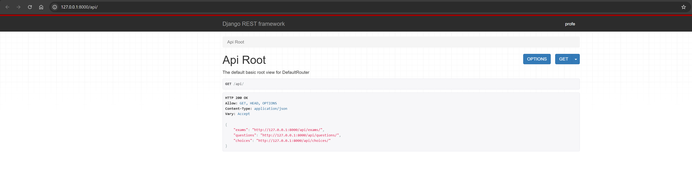
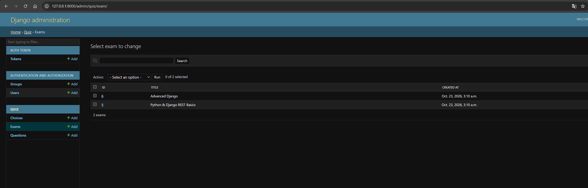
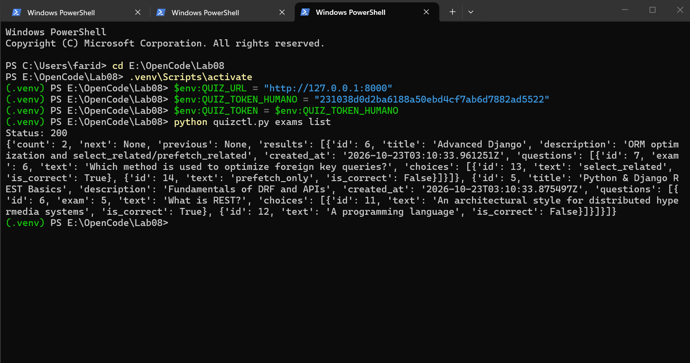
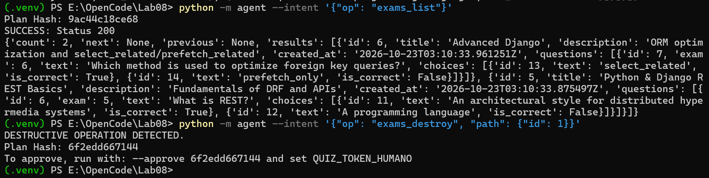

# Lab08: API Headless — Contrato, Cliente de Consola y Frontera del Agente

Este repositorio contiene el desarrollo del proyecto Lab 08 de Desarrollo de Aplicaciones Empresariales (DAE), enfocado en la construcción y exposición de una API de cuestionarios (*Headless API*) mediante Django REST Framework, la implementación de un contrato OpenAPI, un cliente de consola robusto (`quizctl.py`), control de permisos granulares en el servidor (separando identidades de humanos y agentes de IA), y una pasarela de ejecución segura con auditoría de intenciones.

## 🚀 Descripción General del Proyecto

El sistema es una API backend de cuestionarios construida en Django que gestiona exámenes, preguntas y opciones de respuesta. El proyecto aborda cuatro ejes principales:

1. **El Contrato (OpenAPI):** Generación automática y validación del contrato de la máquina mediante `django-spectacular` (`schema.yml`) e interfaz interactiva Swagger UI / ReDoc.
2. **Cliente de Consola (`quizctl.py`):** Un cliente sin interfaz gráfica para listar, crear, ver detalles y eliminar recursos, con códigos de salida normalizados según el estado HTTP y gestión de cuerpos de peticiones JSON.
3. **Identidades y Permisos en el Servidor (`quiz/permissions.py`):** Reglas de seguridad estrictas donde la persona (*profe*) tiene acceso total, el grupo `agente` puede leer, crear y modificar pero **nunca borrar** (recibiendo `403 Forbidden` ante cualquier intento destructivo), y los demás tienen acceso de solo lectura.
4. **Frontera del Agente de IA (`agent/gateway.py`):** Pasarela cerrada de intenciones con validación de contratos, cálculo de huellas criptográficas SHA-256, aprobación obligatoria con token humano para operaciones destructivas, y registro de auditoría en `agent_audit.jsonl`.

## 🔗 Enlaces de Acceso Local (Desarrollo)

Una vez ejecutado el servidor (`python manage.py runserver`), puedes acceder a:
- **Centro de Control e Inicio:** http://127.0.0.1:8000/
- **Documentación Interactiva (Swagger UI):** http://127.0.0.1:8000/api/docs/
- **Referencia ReDoc:** http://127.0.0.1:8000/api/redoc/
- **API Navegable (DRF):** http://127.0.0.1:8000/api/
- **Panel de Administración (Django Admin):** http://127.0.0.1:8000/admin/
  - *Credenciales:* `profe` / `profe123`

## 📋 Resumen de Implementación y Puesta en Marcha

1. **Entorno y Dependencias:**
   ```powershell
   python -m venv .venv
   .venv\Scripts\activate          # en Windows
   pip install -r requirements.txt
   python manage.py migrate
   python manage.py seed_quiz      # Carga datos y genera los tokens de profe y agente
   python manage.py runserver      # Deja corriendo en una terminal
   ```

2. **Ejecución del Cliente de Consola (`quizctl.py`):**
   ```powershell
   $env:QUIZ_URL = "http://127.0.0.1:8000"
   $env:QUIZ_TOKEN_HUMANO = "..."  # Token impreso por seed_quiz
   $env:QUIZ_TOKEN_AGENTE = "..."
   $env:QUIZ_TOKEN = $env:QUIZ_TOKEN_HUMANO

   python quizctl.py exams list
   python quizctl.py questions create --exam 3 --text "¿Qué es REST?" --choice "Un estilo:ok" --choice "Un lenguaje"
   ```

3. **Pruebas de la Pasarela del Agente (`agent`):**
   ```powershell
   python -m agent --intent '{"op": "exams_list"}'
   python -m agent --intent '{"op": "exams_destroy", "path": {"id": 1}}' --approve <hash>
   ```

4. **Ejecución de Pruebas Unitarias:**
   ```powershell
   python manage.py test
   ```

## 📐 Modelos del Sistema (`quiz/models.py`)

- **Exam (Examen):** `title` (título), `description` (descripción) y `created_at` (fecha de creación).
- **Question (Pregunta):** Relación ForeignKey con Exam, y `text` (enunciado). Incluye validación estricta en el serializador para aceptar únicamente preguntas con **exactamente una opción correcta**.
- **Choice (Opción):** Relación ForeignKey con Question, `text` (texto de la opción) y `is_correct` (booleano indicador de respuesta correcta).

## 🤖 Agentes Utilizados en opencode

Durante el desarrollo de este laboratorio, se configuraron y utilizaron subagentes especializados bajo `.opencode/agent/`:
- **django-dev:** Especializado en modelos, serializadores derivados (`ModelSerializer`), validadores personalizados de DRF, viewsets y reglas de permisos en el servidor.
- **cli-gateway:** Especializado en el desarrollo del cliente de consola `quizctl.py`, esquemas OpenAPI y pasarelas seguras de agentes con auditoría de intenciones.

## 📦 Estructura de Commits del Repositorio

El historial de versiones se encuentra organizado en 8 commits atómicos documentados en español:
- `696e588` - Adición de la documentación README.md del laboratorio 08
- `0f969fa` - Implementación de la pasarela y frontera segura del agente de IA (agent/) con auditoría
- `5936e59` - Desarrollo del cliente de consola (quizctl.py), contrato OpenAPI (schema.yml) y pruebas unitarias
- `2a0f760` - Configuración de permisos estrictos en el servidor para prohibir borrados al agente
- `0d76dca` - Implementación de ViewSets, filtrado, búsqueda, paginación, panel de administración y rutas de la API
- `93a8c04` - Implementación de serializadores con validación de opción correcta única y relaciones anidadas
- `1769fc7` - Creación del comando de inicialización de datos y tokens (seed_quiz)
- `656b564` - Implementación de modelos en singular (Exam, Question, Choice) y migraciones iniciales
- `a013b9a` - Configuración inicial del proyecto Django, dependencias y estructura base

## 📸 Capturas y Evidencias del Proyecto

A continuación se muestran las principales evidencias del funcionamiento, verificación y pruebas del proyecto almacenadas en la carpeta `Evidencias_lab08/`:

1. **Centro de Control e Inicio:**
   

2. **Documentación Interactiva (Swagger UI):**
   

3. **API Navegable de Django REST Framework:**
   

4. **Panel de Administración de Django:**
   

5. **Ejecución del Cliente de Consola (`quizctl.py`):**
   

6. **Pasarela de Seguridad del Agente de IA:**
   
